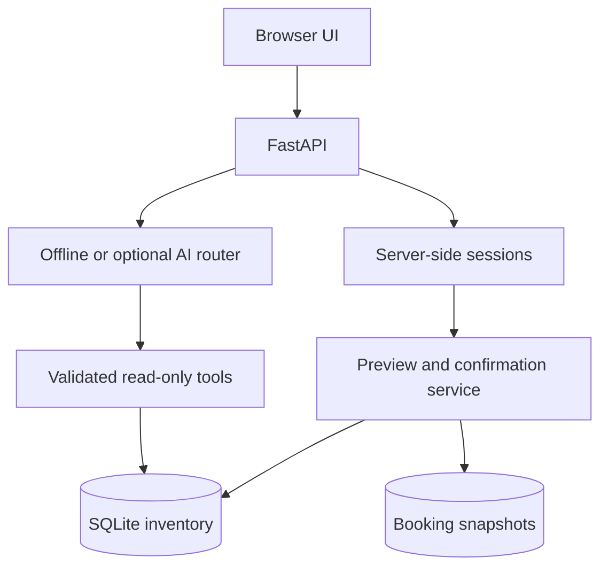

# Showroom Copilot - Project 02

An AI-assisted, course-inspired car showroom application with inventory-grounded answers, exact car comparisons and explicitly confirmed **synthetic booking requests**. It adapts the airline tool-calling exercise to Pranil Deshmukh's showroom domain.

**All brands, models, prices and stock are fictional. There are no real vehicle reservations, payments or sales.** This is a local portfolio demo, not a production dealership service.

## What is implemented

- Responsive browser interface with filter controls, inventory cards, comparisons and tool-call inspection.
- Twelve fictional cars with integer-INR prices, fuel, transmission, body type, seat count, demo stock and inventory version.
- No-key offline query routing for simple budgets (including lakh/crore), brand, fuel, body type and transmission.
- Optional hosted AI routing: the model returns a validated, read-only tool plan; all displayed inventory comes from the database. No model-generated prices are used.
- Account registration/sign-in using salted scrypt hashes, opaque server-side sessions and HttpOnly/SameSite cookies.
- Ten-minute booking previews, explicit confirmation, transactional stock/price/version checks, replay-safe confirmation and cancellation.
- User-scoped booking history with the original car/price snapshot.
- SQLite persistence, automated unit/API/concurrency checks, browser-smoke CI and interview documentation.
- Optional browser text-to-speech for the answer. This is not a hosted voice-agent integration.

## Get this project

Project 1 remains on the repository's default `finance` branch. Project 2 is an independent application at the root of `project-02-car-showroom`:

```sh
git clone --branch project-02-car-showroom --single-branch https://github.com/pra986/source-backed-brochures.git car-showroom-assistant
cd car-showroom-assistant
```

A separate repository can be used later without changing the application package. The downloaded ZIP already contains this project's files; after extracting it, enter the folder with `pyproject.toml`.

## Run locally - Python 3.11+

```sh
python -m venv .venv
```

Activate on Windows PowerShell:

```powershell
.venv\Scripts\Activate.ps1
```

Or macOS/Linux:

```sh
. .venv/bin/activate
```

Install and start:

```sh
python -m pip install -e .
python -m uvicorn showroom.app:app --host 127.0.0.1 --port 8000
```

Open **http://127.0.0.1:8000**. No API key is needed for offline mode. Browse cars, ask `Show automatic cars under 12 lakh`, and compare `CAR-001` with `CAR-002`. Register a test identity with a unique demo password of 10-128 characters before trying a booking request. No email is sent.

## Booking demonstration

1. Search or browse the catalog.
2. Sign in with a local demo account.
3. Select **Request booking** on a car.
4. Review the preview and acknowledge that it is synthetic.
5. Select **Confirm demo request**. The backend rechecks price, version and stock inside a transaction.
6. Open **My requests** to inspect or cancel it.

A preview does not hold stock. If inventory changes after preview, confirmation is rejected and a new preview is required. Repeating confirmation with the same preview returns the same booking; it does not decrement stock again. Replaying a cancelled booking's preview returns its cancelled record, not a new reservation.

## Optional AI mode

Set these environment variables in the server shell **before startup**. `.env.example` is documentation; the app does not load a `.env` file automatically.

```powershell
$env:OPENAI_API_KEY="YOUR_LOCAL_KEY"
$env:OPENAI_MODEL="YOUR_AVAILABLE_CHAT_MODEL"
```

```sh
export OPENAI_API_KEY="YOUR_LOCAL_KEY"
export OPENAI_MODEL="YOUR_AVAILABLE_CHAT_MODEL"
```

Choose **AI** in the routing dropdown. The provider must support an OpenAI-compatible chat-completions endpoint and JSON-object responses. `OPENAI_BASE_URL` defaults to `https://api.openai.com/v1`; only change it to a provider you trust with your key and prompt. Hosted inference availability, cost and routing quality depend on your account. No paid key was used during local verification; provider contracts use mocks.

## Checks

```sh
python -m unittest discover -s tests -v
```

Optional real-browser check (downloads a browser):

```sh
python -m pip install 'playwright>=1.50,<2'
python -m playwright install chromium
python tests/browser_smoke.py
```

The browser check starts an isolated server/database, exercises search, comparison, registration, consent, confirmation, cancellation and logout, checks narrow-screen overflow, and saves screenshots under `evaluation/browser-artifacts/`. On Linux, missing system libraries may require `python -m playwright install --with-deps chromium`.

See [evaluation/results.md](evaluation/results.md) for observed verification and limits. CI is configured to run unit/API checks on Python 3.11-3.13 and a Chromium browser-smoke job.

## API map

| Endpoint | Behavior |
|---|---|
| `GET /api/cars` | Filter inventory; max/min price are inclusive integer INR |
| `GET /api/cars/{id}` | Exact catalog record |
| `POST /api/compare` | Compare 2-3 distinct IDs |
| `POST /api/chat` | Read-only plan and inventory-backed result |
| `POST /api/auth/register`, `/login`, `/logout` | Local account/session management |
| `GET /api/auth/me` | Current identity or null |
| `POST /api/booking-previews` | Authenticated preview; no stock hold |
| `POST /api/bookings/confirm` | Authenticated, explicit, replay-safe confirmation |
| `GET /api/bookings` | Current user's history only |
| `POST /api/bookings/{id}/cancel` | Owner-only, replay-safe cancellation |
| `GET /api/health` | Demo health and AI-configuration indicator |

## Architecture



Read [docs/architecture.md](docs/architecture.md), [docs/data-dictionary.md](docs/data-dictionary.md), [docs/contributions.md](docs/contributions.md) and [docs/interview-guide.md](docs/interview-guide.md).

## SQLite and MySQL

SQLite is implemented so this demo runs without an external database. **There is no MySQL adapter in this release.** [docs/mysql-migration.md](docs/mysql-migration.md) explains the required schema, driver and transactional changes, including row locks. A migration is future work, not a completed feature.

## Deployment limits

Keep this demo bound to localhost. For a shared deployment, supply a trusted hostname list via `TRUSTED_HOSTS`, HTTPS, secure cookies (`COOKIE_SECURE=1`), durable backups, migrations, shared rate limiting, monitoring and an account recovery policy. No real customer data should be entered in this demo.

There is no admin inventory editor, payment provider, email verification, password reset, distributed rate limit, production access audit or real vehicle-stock integration. Sign-in throttling and chat concurrency limits are per process. Registration is not rate-limited. The Content-Length guard is a convenience limit, not a full streaming-body or reverse-proxy budget. SQLite writes are serialized using `BEGIN IMMEDIATE`, suitable for a small demo, not a large shared fleet service.

Offline routing intentionally handles a narrow grammar; ambiguous or unsupported facts get help rather than invented answers. It does not preserve conversation context. Budget caps are inclusive. It does not infer mileage, safety ratings, finance, discounts or real-world performance. Cookie sessions last one day. Local data is stored unencrypted in `.data/showroom.sqlite3`.

## Docker (recipe; build verification is recorded separately)

```sh
docker build -t showroom-copilot .
docker run --rm -p 127.0.0.1:8000:8000 -v showroom-data:/app/.data showroom-copilot
```

Optional `.env` settings can be passed with Docker's `--env-file .env`. Keys are not baked into the image. Stop the server before deleting or backing up the local database.

## Attribution

Inspired by [Ed Donner's LLM Engineering Week 2 airline assistant](https://github.com/ed-donner/llm_engineering/blob/main/week2/day5.ipynb), reviewed at `e9d3397128f9c6177478af82fee077c7a5b11230`. This independently written implementation was produced with AI assistance for Pranil Deshmukh's portfolio. No paid course materials or real car specifications are bundled. Do not present it as unaided personal authorship or a production dealership system.

License: MIT for this implementation; dependency licenses remain their owners'.
