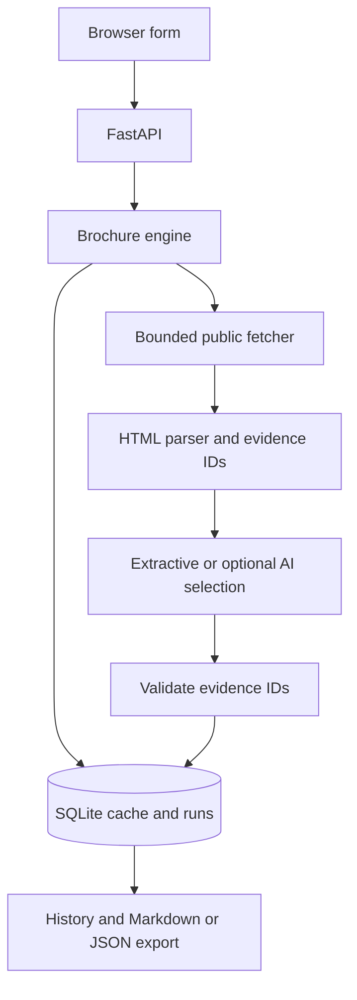

# Source-backed Brochures

A local company-brochure portfolio application that keeps its evidence. Enter a company website, collect up to four HTML pages and export a brochure with source links and replayable snapshots. A fictional demo works without an API key or internet.

**Status:** implemented local portfolio MVP, with automated verification. Not a hosted service. Built with AI assistance for Pranil Deshmukh. Inspired by Ed Donner's LLM Engineering brochure exercise; this repository is an independent implementation, not a fork or claim of sole unaided authorship.

## Features

- Responsive web interface, saved history and printable results.
- Bounded HTML crawling, same-origin links and child-page redirects.
- Public-address validation with pinned TCP peers (preserving TLS hostname checks), a page-byte cap and socket timeouts.
- Extractive brochures: displayed passages come directly from collected pages.
- Optional OpenAI-compatible model **selects evidence IDs only**. Invalid IDs fail closed; generated free-form claims are not used.
- One-hour SQLite page cache, refresh control, immutable per-run text snapshots, fetch timestamps and hashes of decoded HTML.
- Markdown and full JSON snapshot exports; a built-in fictional demo.

## Quick start (Python 3.11+)

```sh
python -m venv .venv
```

Activate it:

```powershell
# Windows PowerShell
.venv\Scripts\Activate.ps1
```

```sh
# macOS / Linux
. .venv/bin/activate
```

Then, from the directory containing `pyproject.toml`:

```sh
python -m pip install -e .
python -m uvicorn brochure.app:app --host 127.0.0.1 --port 8000
```

Open **http://127.0.0.1:8000**, keep **Use fictional demo data** checked and click **Generate brochure**. Sources, history, downloads and printing work without a provider key. The demo company and its claims are synthetic.

## Optional AI selection

Set server environment variables before starting; `.env.example` documents names, but the app does **not** automatically load `.env` files.

```powershell
$env:OPENAI_API_KEY="YOUR_LOCAL_KEY"
$env:OPENAI_MODEL="YOUR_AVAILABLE_CHAT_MODEL"
```

```sh
export OPENAI_API_KEY="YOUR_LOCAL_KEY"
export OPENAI_MODEL="YOUR_AVAILABLE_CHAT_MODEL"
```

Restart the server and choose AI mode. `OPENAI_BASE_URL` defaults to `https://api.openai.com/v1`; change it only to a provider you trust with the key and collected excerpts. The provider must support the chat-completions endpoint and JSON-object response mode. Model availability and cost depend on your account. Hosted inference has not been verified with a paid key in this delivery; its contract is tested with mocks.

## Tests

```sh
python -m unittest discover -s tests -v
```

See [evaluation/results.md](evaluation/results.md) for actual checks and limits. Tests use temporary databases and deterministic fixtures; no keys or paid calls are required.

## Docker (optional; not built in this delivery)

```sh
docker build -t source-backed-brochures .
docker run --rm -p 127.0.0.1:8000:8000 -v brochure-data:/app/.data source-backed-brochures
```

Use `--env-file .env` only when you have populated a local `.env` and intend to enable AI mode. No key is baked into the image. Image build needs network access to install dependencies.

## Architecture



Read [docs/architecture.md](docs/architecture.md) and [docs/interview-guide.md](docs/interview-guide.md).

## Endpoints

| Endpoint | Purpose |
|---|---|
| `GET /` | Web interface |
| `GET /api/health` | Health and provider configuration indicator |
| `POST /api/generate` | Company, URL, demo, AI and refresh options |
| `GET /api/runs` | Recent 30 run summaries |
| `GET /api/runs/{id}` | Exact saved run |
| `GET /api/runs/{id}/export?format=markdown` | Markdown download |
| `GET /api/runs/{id}/export?format=json` | Source snapshot download |

## Limitations

This is a **local, single-user app**. It has no authentication, retention UI, robots.txt enforcement or public-hosting operations. Keep it bound to localhost. The two-request concurrency gate is per process, not a distributed rate limit. Set up authentication, crawl permissions, request budgets, an egress policy, data retention and operational monitoring before a shared deployment.

Only static HTML is supported; JavaScript-only pages, blocked websites, PDFs and nonstandard ports are rejected or yield no evidence. Content is decoded as UTF-8 with replacement; some encodings may lose text. The extractor is deliberately simple. Captured source text is evidence of what a page said, not independent proof that the company claims are true. AI mode selects excerpts rather than writing a polished marketing narrative. Evidence can still contain misleading or malicious website text, so review before sharing. A brochure is not automatically a reliable company assessment.

Source texts and run history are stored unencrypted locally in `.data/`. Do not use sensitive input. Clear the data directory only after stopping the app and backing up anything you want to keep. Public-address validation is defense in depth, not a substitute for deployment-level egress restrictions.

## Attribution and contribution record

- Course inspiration: [Ed Donner, LLM Engineering, Week 1 Day 5](https://github.com/ed-donner/llm_engineering/blob/main/week1/day5.ipynb).
- Reviewed inspiration snapshot: `e9d3397128f9c6177478af82fee077c7a5b11230`.
- No course code, paid materials, branding assets or real business content are bundled.
- Implementation was generated and verified with AI assistance in this collaboration. See [docs/contributions.md](docs/contributions.md) for the actual work and [docs/portfolio-status.md](docs/portfolio-status.md) for remaining projects.

License: MIT for this independent implementation. Dependency licenses remain their owners'.
