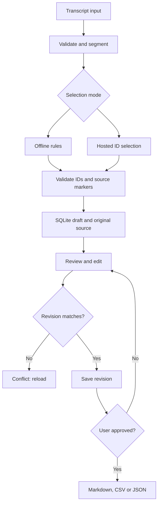

# Architecture and project flow

The browser renders a same-origin FastAPI app. SQLite is the local source of truth; provider credentials stay on the server. No external queue, vector database or LLM framework is needed for this scope.

Optional audio is a separate input step: explicit user confirmation → raw upload → bounded provider request → text returned to the input box → user reviews transcript → ordinary analysis. It never automatically approves or analyzes returned text.

## Modules

| Module | Responsibility |
|---|---|
| `minutes/app.py` | HTTP routes, same-origin write checks, host validation, request limits, concurrency gate |
| `minutes/extract.py` | Parse stable source segments, conservative rules, validate selected IDs, construct extractive items |
| `minutes/providers.py` | Optional hosted AI selection and transcription, bounded timeouts, sanitized errors |
| `minutes/storage.py` | SQLite transactions, compare revision, immutable source and history, deletion |
| `minutes/exports.py` | Approval gate, source references, Markdown escaping and CSV formula neutralization |
| `minutes/static/index.html` | Review interface, draft state, source inspection, exports and local history |

## Stored records

`meetings` stores ID, current revision, update time and the complete JSON record. `history` stores a JSON snapshot keyed by meeting ID/revision and cascades on delete. A meeting contains the title, original submitted transcript after outer whitespace normalization, source SHA-256, source segments, items, mode, approval status and timestamps. Segment IDs (`S001`) are stable within one meeting; they are not global IDs. Items hold the source ID/quote separately from editable text, owner, due text and inclusion. Manual additions use UUID item IDs and `user-added` provenance.

A transaction obtains a write lock with `BEGIN IMMEDIATE`, verifies the submitted revision, applies changes and inserts the next history snapshot. Concurrent saves of the same revision cannot silently overwrite one another. The UI locks downloads for unsaved edits; the API exports only the saved reviewed revision. Approving a new revision does not prove its text matches the source.

## Boundaries and extensions

JSON requests are schema-validated; source strings are rendered as text rather than HTML. Host and Origin checks reduce accidental cross-site use, but are not authentication. Regular JSON size checking relies on Content-Length and field limits; a production gateway must enforce streaming request limits too. Audio streaming is explicitly capped at 20 MiB. Two analysis/provider operations can run concurrently per process; this is not a shared rate limit across workers. SQLite and full history suit a small local demo; large recordings and large-scale history require a different storage design.

Before a multi-user deployment, add identity and ownership authorization, TLS, protected secrets, retention policy, streaming limits, quotas, observability and provider-specific evaluations. These are future work, not implemented capabilities.
