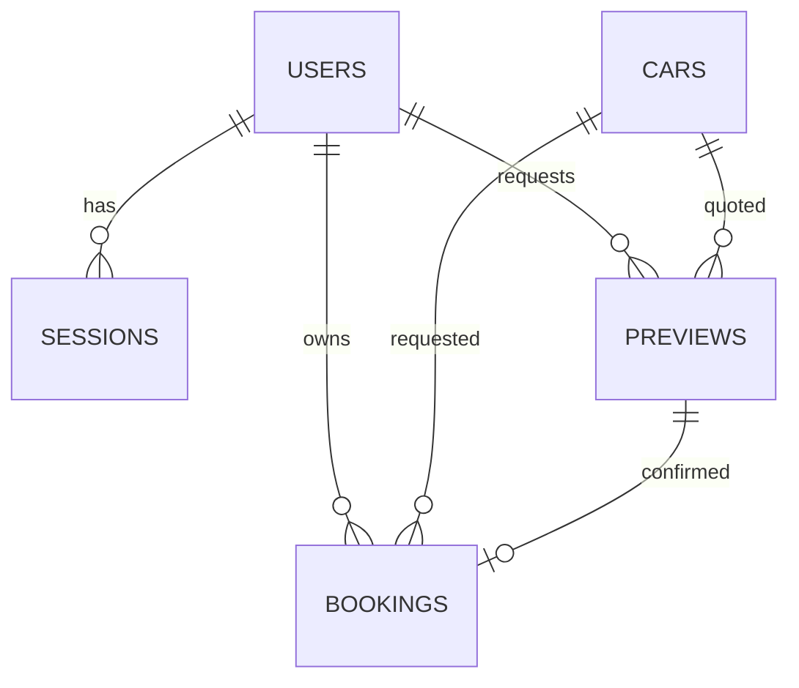

# Data dictionary

All IDs are server-generated except the fixed synthetic car IDs. Amounts are integer INR; there are no floating-point currency calculations.

| Table | Fields | Key rules |
|---|---|---|
| cars | id, brand, model, variant, price_inr, fuel, transmission, body_type, seats, stock, version | ID primary key; price/stock nonnegative; each stock change increments version |
| users | id, name, email, password_hash | Email normalized lowercase and unique; salted scrypt value only |
| sessions | token_hash, user_id, expires | Token hash primary key; FK user; one-day expiry |
| previews | id, user_id, car_id, price_inr, version, expires, created | FK user/car; 10-minute expiry; preview does not change stock |
| bookings | id, user_id, car_id, preview_id, price_inr, car_snapshot, status, created, cancelled | Unique preview FK prevents duplicate confirmation; status confirmed/cancelled; snapshot retained |

`car_snapshot` stores the car record at confirmation, before decrementing its stock. Its price is the confirmed request price; the live car record may later change. No customer ID is accepted from the browser as the authority for a write.

